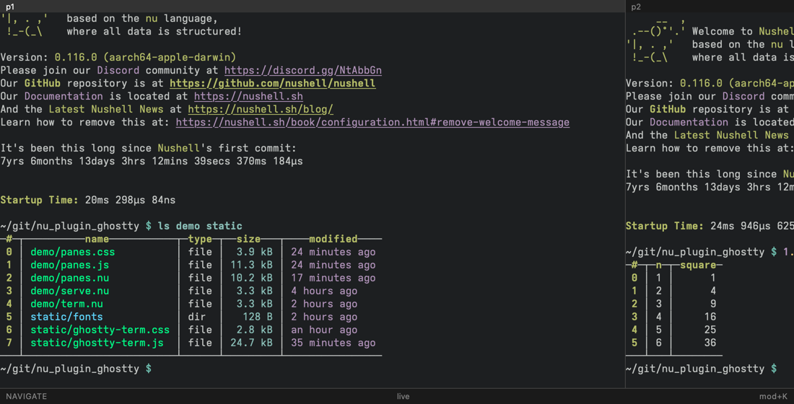

# nu_plugin_ghostty

Ghostty in a web page, as plain HTML. There's no terminal emulator in the browser: no xterm.js, no ghostty-web. The terminal lives on the server. This Nushell plugin runs each program in [libghostty-vt](https://github.com/ghostty-org/ghostty), Ghostty's terminal emulator as a library, and projects its screen as plain HTML: the rows the page is scrolled to, scrollback included, colours and all. In the browser, `<ghostty-term>`, a [Datastar Rocket](https://data-star.dev) web component, shows those rows and sends your keys back.

In the page, a terminal is one tag:

```html
<ghostty-term src="/term"></ghostty-term>
```

Behind `/term`, [http-nu](https://github.com/cablehead/http-nu) answers with the plugin:

```nu
let t = ghostty spawn [bash -l] --cols 100 --rows 30
$t | ghostty input "ls\r"
$t | ghostty window 0 30      # rows 0 to 29, as HTML
```

`demo/term.nu` is the whole server for one terminal.



## Commands

```nu
ghostty spawn [bash -l] --cols 100 --rows 30   # start a program; returns its handle
$t | ghostty input "ls\r"                      # type text into it
$t | ghostty key ArrowUp --mods 4              # a key, as a browser names it
$t | ghostty paste "two\nlines"                # paste, bracketed if the program asked for that
$t | ghostty resize 120 40
$t | ghostty mouse press --button left --x 4 --y 2
$t | ghostty focus true
$t | ghostty window 1200 30                    # {fp, top, total, rows, cols, links, html}
$t | ghostty window 1200 30 --fp $fp           # {unchanged: true} if nothing changed
$t | ghostty changes                           # a stream: one record each time the program writes
$t | ghostty palette                           # the <style> block the HTML's colours refer to
$t | ghostty info                              # {total, rows, cols, seq, alive}, and the exit code once it ends
$t | ghostty close                             # end the program; its handle is never used again
ghostty changes --all                          # every terminal's changes on one stream
```

Row 0 is the oldest line kept. A terminal keeps 10,000 lines of scrollback unless you pass `--scrollback`.

Mouse and focus reports reach the program only when it asked for them, the same as in a real terminal.

## Links

`ghostty window` finds web addresses in the text and returns them as `links`, so the page can make them clickable. An address that wraps across several rows is still found whole. It uses Ghostty's own rule for where an address ends, so `Rust_(video_game)` keeps its brackets and a full stop after an address is left out. Only http, https and mailto addresses become links, including ones the program marked itself with OSC 8.

## ghostty-term

`static/ghostty-term.js` is the element. It's modelled on [ptyZZZ](https://github.com/cablehead/ptyZZZ)'s `<pty-term>`. It parses no escape codes and keeps no terminal state: it places the HTML rows the server sends.

It sizes the terminal to fit its box, follows the live output, and stops following when you scroll up. It asks `{src}/win` for the rows at its scroll position and keeps only those in the page, so a long history doesn't slow the page down. Keys, composed text and paste go to `{src}/input`. Hold Shift to select text when the program has taken the mouse.

## Demos

Both demos run under http-nu with `--datastar-rocket`.

`demo/term.nu` is one terminal in a page:

```sh
http-nu --datastar-rocket --plugin ./nu_plugin_ghostty 127.0.0.1:3012 demo/term.nu
```

`demo/panes.nu` is many terminals in columns, after [ptyZZZ's panes example](https://github.com/cablehead/ptyZZZ/tree/main/examples/panes). You open, split and close panes while the page is up, and every open window follows along. Press Cmd+K to see the keys. All the terminals share one connection to the server. Each pane runs `nu` if it's on your PATH, or your login shell if not; set `GHX_PANE_CMD` to run something else.

```sh
http-nu --datastar-rocket --store ./store --plugin ./nu_plugin_ghostty 127.0.0.1:3015 demo/panes.nu
```

## Build

You need Zig 0.17.1 and libghostty-vt 1.0.1, which comes as `ghostty-vt-1.0.1.xcframework.zip` from <https://release.files.ghostty.org/libghostty-vt/1.0.1/>. Unzip it and point `VT` at its macOS directory:

```sh
VT=path/to/ghostty-vt.xcframework/macos-arm64_x86_64 ZIG=path/to/zig ./build.sh
plugin add ./nu_plugin_ghostty
```

The build script is for macOS only for now.

## License

MIT. See [LICENSE](LICENSE).
