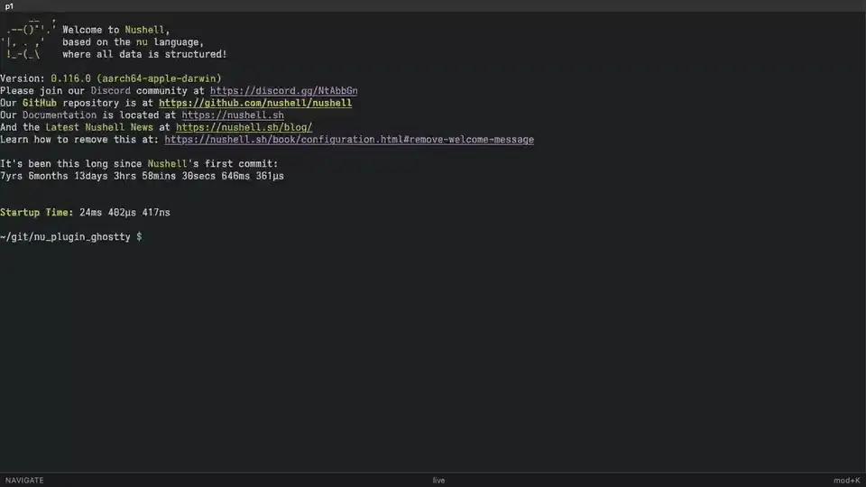

# nu_plugin_ghostty

nu_plugin_ghostty projects terminals into a web page as plain HTML. The terminal itself stays on the server, in [libghostty-vt](https://github.com/ghostty-org/ghostty), Ghostty's terminal emulator as a library. The browser runs no terminal emulator: no xterm.js, no ghostty-web. It shows the HTML it is sent and sends your keys back.



## The projection

The plugin runs each program in a libghostty-vt terminal on the server. The page asks for the rows it is showing, and the plugin answers with those rows as HTML, in their colours. Rows that scroll off the top stay on the server, so the page can scroll back through all of them while it holds only what is in view. Each time the program writes, the plugin sends a tick, and the page asks again for the rows it shows.

## ghostty-term

`<ghostty-term>` is the page's side of the projection: a [Datastar Rocket](https://data-star.dev) web component in `static/ghostty-term.js`, modelled on [ptyZZZ](https://github.com/cablehead/ptyZZZ)'s `<pty-term>`. It parses no escape codes and keeps no terminal state; it places the rows the server sends. You put a projected terminal in a page with the tag, pointed at the address that serves it:

```html
<ghostty-term src="/term"></ghostty-term>
```

The element listens for ticks on `{src}/live`, asks `{src}/win` for rows, and posts keys, text, pastes and its size to `{src}/input`. It fits the terminal to its box, follows the live output, and stops following when you scroll up. A button then shows at its bottom right that jumps back to the bottom; the element's children, an `ICONIFY` icon say, are that button's icon. Hold Shift to select text when the program has taken the mouse.

## The plugin

[http-nu](https://github.com/cablehead/http-nu) serves those addresses by calling the plugin. `demo/term.nu` is a whole server for one terminal.

```nu
ghostty spawn [bash -l] --cols 100 --rows 30   # start a program; returns its handle
$t | ghostty input "ls\r"                      # type text into it
$t | ghostty key ArrowUp --mods 4              # a key, as a browser names it
$t | ghostty paste "two\nlines"                # paste, bracketed if the program asked for that
$t | ghostty resize 120 40
$t | ghostty mouse press --button left --x 4 --y 2
$t | ghostty focus true
$t | ghostty window 1200 30                    # rows from 1200, as HTML: {fp, top, total, rows, cols, links, html}
$t | ghostty window 1200 30 --fp $fp           # {unchanged: true} if nothing changed
$t | ghostty changes                           # the ticks: a record each time the program writes
$t | ghostty palette                           # the <style> block the HTML's colours refer to
$t | ghostty info                              # {total, rows, cols, seq, alive}, and the exit code once it ends
$t | ghostty close                             # end the program; its handle is never used again
ghostty changes --all                          # every terminal's ticks on a single stream
```

Row 0 is the oldest line kept. A terminal keeps 10,000 lines of scrollback unless you pass `--scrollback`. Mouse and focus reports reach the program only when it asked for them, as in any terminal.

## Links

`ghostty window` finds web addresses in the terminal's text and returns them as `links`, so the page can make them clickable. An address that wraps across rows is still found whole. The plugin uses Ghostty's own rule for where an address ends, so `Rust_(video_game)` keeps its brackets and a full stop after an address is left out. Only http, https and mailto addresses become links, including the ones a program marks itself with OSC 8.

## Demos

The demos run under http-nu with `--datastar-rocket`.

`demo/term.nu` projects one terminal into a page:

```sh
http-nu --datastar-rocket --plugin ./nu_plugin_ghostty 127.0.0.1:3012 demo/term.nu
```

`demo/panes.nu` projects many, in columns, after [ptyZZZ's panes example](https://github.com/cablehead/ptyZZZ/tree/main/examples/panes). You open, split and close panes while the page is up, and every open window follows along. Cmd+K shows the keys. Every pane's ticks reach the page on a single stream. Each pane runs `nu` if it's on your PATH, or your login shell if not; `GHX_PANE_CMD` runs something else.

```sh
http-nu --datastar-rocket --store ./store --plugin ./nu_plugin_ghostty 127.0.0.1:3015 demo/panes.nu
```

## Build

The build needs Zig 0.17.1 and libghostty-vt 1.0.1, which comes as `ghostty-vt-1.0.1.xcframework.zip` from <https://release.files.ghostty.org/libghostty-vt/1.0.1/>. Unzip it and point `VT` at its macOS directory:

```sh
VT=path/to/ghostty-vt.xcframework/macos-arm64_x86_64 ZIG=path/to/zig ./build.sh
plugin add ./nu_plugin_ghostty
```

The build script is for macOS only for now.

## License

MIT. See [LICENSE](LICENSE).
